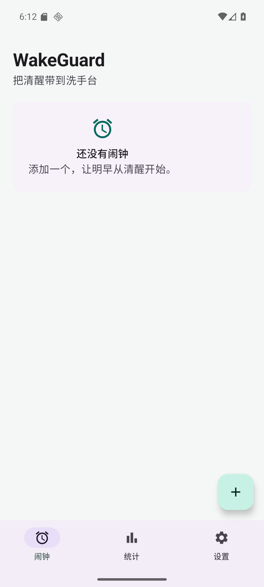
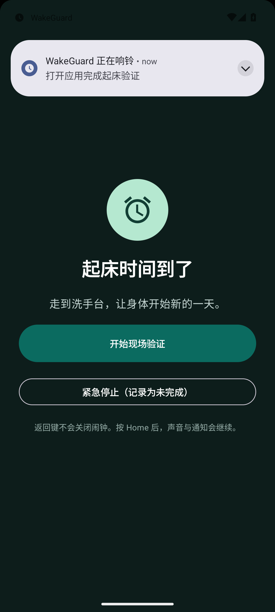
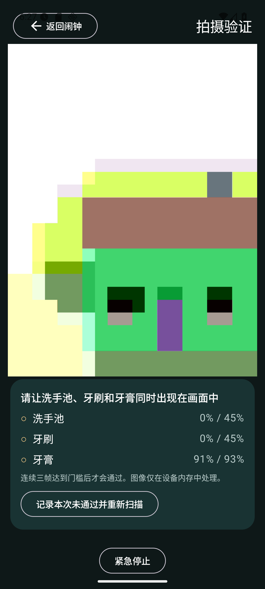
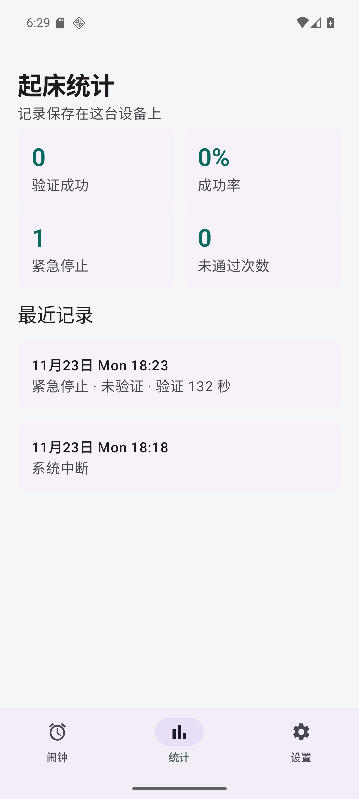

# WakeGuard

WakeGuard is an offline-first Android alarm prototype. It schedules exact alarm-clock events, keeps ringing through normal app backgrounding, and offers a live CameraX task intended to check for a sink, toothbrush, and toothpaste before recording a successful wake-up.

The app is an alpha. Sink and toothbrush are recognized by Google's COCO-trained EfficientDet-Lite0 model. Toothpaste is classified by a small MobileNetV3-Small model trained locally from scratch on two toothpaste categories in the MIT-tagged MIMEX product dataset. Product-image metrics do not establish real bathroom-scene performance: **none of the four licensed complete bathroom scenes tested passed all three production thresholds**, so end-to-end camera verification remains unvalidated and the prerelease gate is closed. See [AI model notes](docs/AI_MODEL.md) for measured scores and limits.

## Features

- One-time, daily, weekday, and custom weekday alarms stored in Room.
- Exact `setAlarmClock()` scheduling, ringtone selection, vibration, and boot/timezone recovery.
- Media playback foreground service, ongoing notification, and lock-screen full-screen entry when Android grants it.
- CameraX live preview with on-device object detection and ONNX classification. Images stay in memory and are not saved.
- Verification only succeeds after all three scores cross their configured thresholds for three consecutive frames.
- Deliberate emergency stop records an unsuccessful outcome. Back does not dismiss an active task.
- Local wake history, verification duration, emergency stops, and manually recorded failed attempts.

## Build and run

The verified Windows setup for this workspace is documented in [docs/SETUP.md](docs/SETUP.md). With Android SDK API 36 and Java 17 or newer configured:

```powershell
. '.\scripts\set-local-environment.ps1'
.\gradlew.bat assembleDebug
.\gradlew.bat testDebugUnitTest
.\gradlew.bat connectedDebugAndroidTest
```

The debug APK is created at `app/build/outputs/apk/debug/app-debug.apk`. Exact-alarm, notification, full-screen-intent, and camera access must be granted by the user in Android settings or in the app's permission flow.

## Emulator screenshots

These screenshots were captured on the API 36 Android Emulator. The camera image is the emulator's synthetic virtual-camera feed; it scored sink 0%, toothbrush 0%, toothpaste 91% against thresholds 45%, 45%, and 93%, so it did not verify a wake-up.

| App state | Screenshot |
| --- | --- |
| Alarm list |  |
| Active alarm |  |
| Live camera and model scores |  |
| Wake history after emergency stop and system interruption |  |

Execution logs and the final acceptance report are kept outside Git under `D:\workshop\nov\reports`.

## Platform limits

Android may restrict exact alarms, full-screen notifications, background launches, and power behavior. An ordinary app cannot prevent force-stop, shutdown, reboot, or system-level volume controls. Emulator results do not validate physical camera or speaker hardware. See [Android limitations](docs/ANDROID_LIMITATIONS.md) and [known issues](docs/KNOWN_ISSUES.md).

## License

WakeGuard source code is MIT licensed. Third-party software and model notices are listed in [THIRD_PARTY_NOTICES.md](THIRD_PARTY_NOTICES.md).
