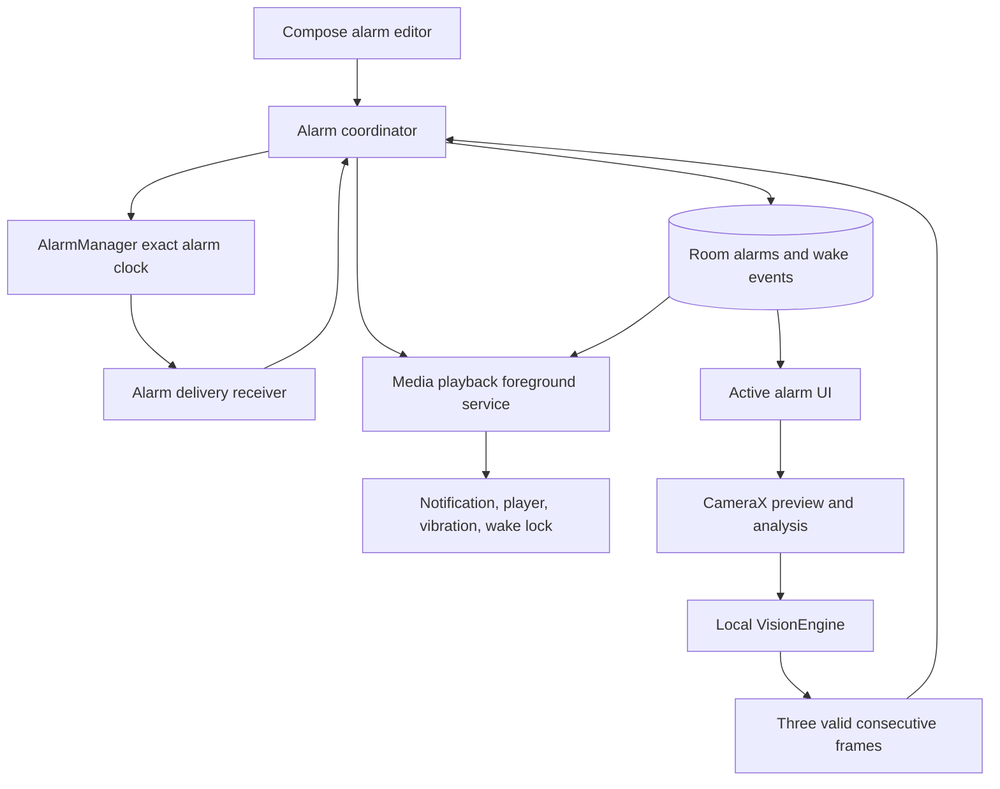
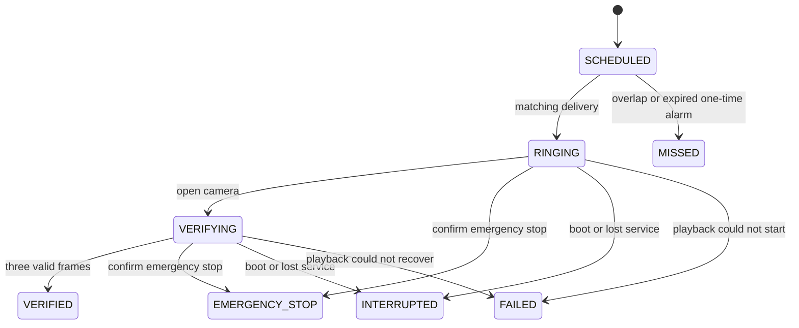

# Architecture

WakeGuard runs in a single Android application process. Room stores configured alarms and their wake events.

## Alarm ownership

Each registration carries a due epoch and a unique token. Room records the token after Android accepts registration. Editing, disabling or deleting an alarm invalidates the old token. The receiver checks the stored token and atomically consumes a matching due occurrence. A repeat registers the next occurrence even when another event owns playback. The first event continues and the overlapping occurrence is recorded as missed.

The service observes the active Room event and owns one player, vibration request and wake lock. A prepared callback checks the current event and player under the same lock as terminal writes. A null sticky restart looks up the active event. A service with no active event releases its resources and stops. Each playback event keeps its own ringtone and vibration options. The configured ringtone is tried before the system alarm tone and the bundled backup tone.

Schema v2 adds registration and event playback fields. Room preserves existing alarms, history and active playback settings. The active event takes precedence over the app's normal tabs and editor. Terminal events clear lock-screen and screen-on flags.

## Vision and privacy

CameraX shares a view port between preview and analysis. Frames honor RGBA strides, crop and rotation. A worker owns model use and cleanup. Pausing the activity or display invalidates the attempt. Duplicate timestamps, stale frames, invalid scores and errors cannot advance the sequence. Threshold preferences are captured on entry to the camera screen.

The on-device engine sends the letterboxed frame and overlapping crops to EfficientDet-Lite0 and uses the training-time crop geometry for the toothpaste classifier. The UI shows per-object scores. A product class score has no toothpaste box to display. Camera frames are processed in memory.
