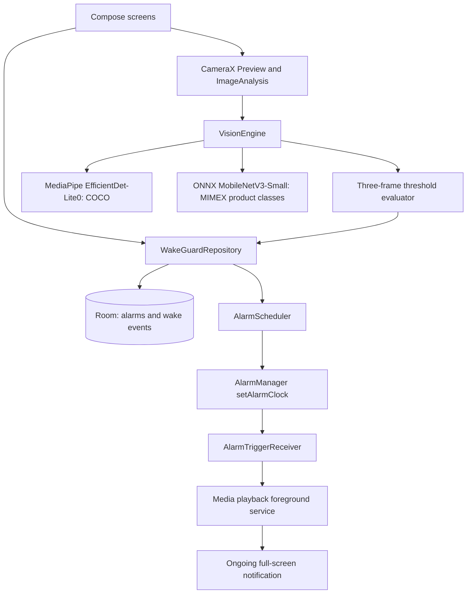
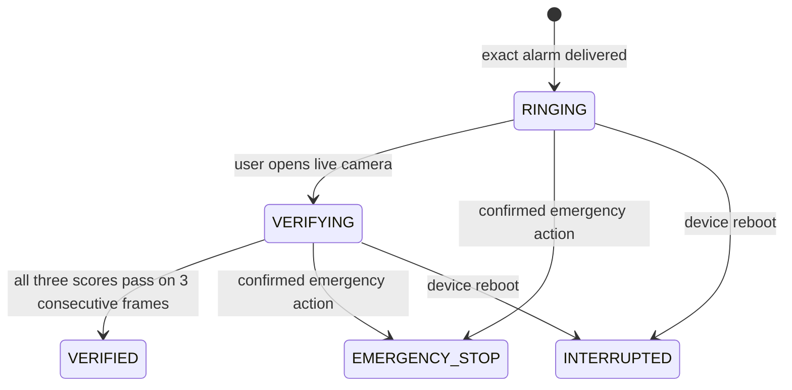

# Architecture

WakeGuard uses a small MVVM-style Android app with explicit domain rules and replaceable camera inference.

## Boundaries

- `domain`: local-time recurrence calculation and confidence/continuity rules. These classes have no Android dependency and are unit tested.
- `data`: Room entities, DAOs, schema, and repository operations. Event completion uses conditional SQL updates so duplicate success/emergency requests cannot overwrite a terminal outcome.
- `alarm`: exact scheduling, trigger/restore receivers, and the media playback foreground service.
- `vision`: the replaceable `VisionEngine` contract, CameraX frame handling, MediaPipe COCO detector, and ONNX toothpaste classifier.
- `presentation`: Compose alarm, edit, ringing, camera, result, statistics, and permission screens.

## Alarm event state

Manual failed attempts increment an event counter and leave the alarm active. A missing model, missing camera permission, or inference exception never returns a passing frame.

## Persistence and privacy

Room stores alarm configuration and wake-event timestamps/outcomes. Only camera frames are used for inference; the app does not write them to storage. Confidence thresholds are local app preferences. No account, backend, network permission, cloud inference, or paid API is used by the app.
