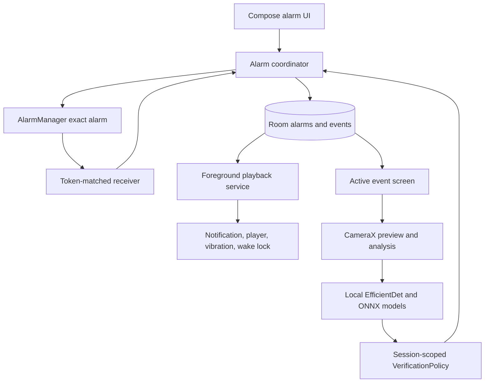
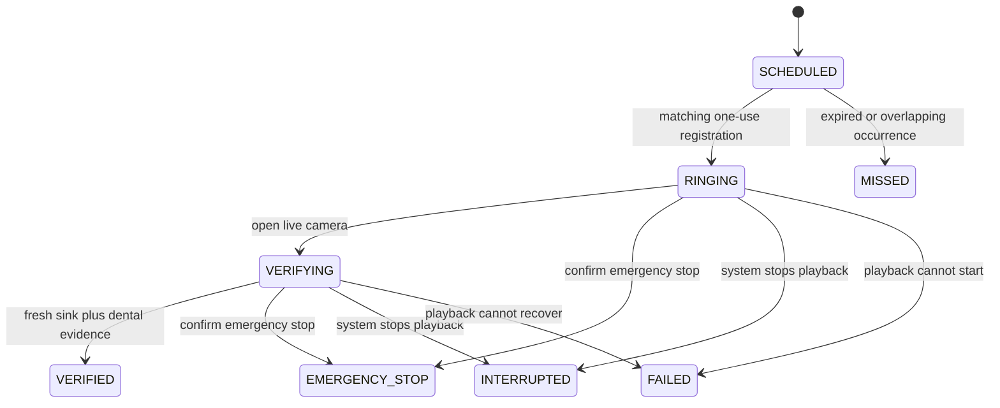

# Architecture

WakeGuard runs as one Android application process. Room is the durable owner of alarm definitions and wake events. Android `AlarmManager` owns exact delivery after WakeGuard registers an enabled occurrence.

## Alarm ownership

Each registration has a due epoch and unique token. Editing, disabling, or deleting an alarm invalidates its previous registration. Delivery checks the stored token and due occurrence, then consumes that registration transactionally before creating a wake event. A repeat schedules its next due occurrence even when another event owns playback; overlapping deliveries are recorded as missed without displacing the active event.

The foreground service owns one event, audio player, vibration request, notification, and wake lock. Playback callbacks recheck event and player ownership before they act. A sticky restart reads the active Room event and resumes that same event. Terminal state releases its playback resources and removes its ongoing notification. Emergency stop remains an explicitly confirmed, unverified terminal result.

Room schema v2 stores registrations, playback settings and event outcomes. While an event is active, its screen replaces ordinary tabs and the alarm editor. Back during ringing is consumed; Back during camera verification returns to ringing without completing or stopping the event. Home and task removal do not own the playback service.

## Camera and privacy

CameraX binds one shared view port to preview and image analysis. The analyzer honors RGBA row and pixel strides, crop and rotation, and closes every `ImageProxy`. Inference uses bundled offline models. Frames, scores and accumulated evidence remain in memory; camera images are not written to Room or uploaded.

`VerificationPolicy` is immutable for an alarm camera attempt. The production policy is session-accumulated sink plus either toothbrush or toothpaste evidence, with thresholds 0.25, 0.25 and 0.40 respectively. It needs two fresh relevant frames within 12 seconds. Returning from the camera, pausing the app, screen-off, permission loss, stale/duplicate frames, inference errors, and camera closure invalidate the attempt. A new alarm event gets a new evaluator. See [AI model and verification](AI_MODEL.md).
