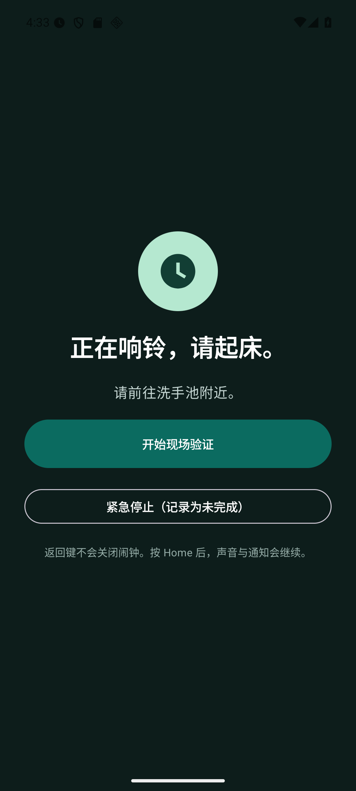
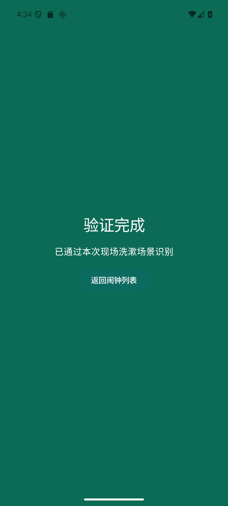

# WakeGuard Round 3 final acceptance report

## 1. Executive summary

**CI and release status: pending the first pushed Round 3 candidate.** Local Windows/API 36 checks passed, including the revised real-model gate and three actual scheduled CameraX-to-`VERIFIED` AVD runs. A scheduled obvious-unrelated CameraX run stayed unverified and was explicitly emergency-stopped. APK candidates were built, signature-checked and hashed. The GitHub Actions run and release decision will be added after push; no release is published at this stage.

WakeGuard is **a personal anti-snooze alarm with lightweight offline camera verification**, not a high-precision computer vision system or an authentication product.

## 2. Revised product requirements

The owner explicitly revised Round 3 acceptance: preserve reliable exact alarms and playback, prevent casual Back/Home dismissal, require live CameraX inference for normal verification, retain emergency stop, and use approximate wash-area object evidence. The former strict three-object target, 30+30 holdout, zero-false-positive target and 90% simultaneous requirement are canceled. This authorized scope change is documented; Round 2 failures and datasets remain intact.

## 3. Round 2 baseline

Base commit: [`2486dc75deb83e79aef203b62915fb9d597783ba`](https://github.com/miku-wwl/WakeGuard/commit/2486dc75deb83e79aef203b62915fb9d597783ba). Before editing, local and remote `main` matched and the worktree was clean. Baseline reproduction passed 15 JVM and 19 API 36 functional tests; strict vision accepted 0/4 historical positives and 0/2 independent positives, and 0/33 incomplete holdout scenes. No integrated CameraX run reached `VERIFIED`; no public release existed. The initial x86_64 APK was 55,956,001 bytes. See [Round 2 summary](ROUND2_SUMMARY.md).

## 4. Lightweight vision policy comparison

All scores came from actual Android inference with the existing EfficientDet-Lite0/MediaPipe and MobileNetV3-Small/ONNX models. Six labeled washing-area scenes and five visually reviewed, obviously unrelated scenes were used.

| Policy | Positive acceptance | Independent positive | Obvious unrelated acceptance |
|---|---:|---:|---:|
| A: relaxed simultaneous | 2/6 | 1/2 | 0/5 |
| B: sink anchored | 4/6 | 1/2 | 0/5 |
| C: session accumulated | 4/6 | 1/2 | 0/5 |

## 5. Selected verification policy

Policy C is fixed in production: sink ≥0.25 plus toothbrush ≥0.25 or toothpaste ≥0.40 across at least two fresh, relevant frames in a 12-second camera session. It is keyed to one active alarm. Camera close, Back, screen-off/backgrounding, permission loss, invalid inference, stale/duplicate frames and a new alarm reset evidence. No gallery path or fake success route is used. Raw images are processed in memory.

## 6. Before/after vision results

The strict historical model gate remains a named diagnostic and still accepts 0/4 historical and 0/2 independent positives. Under the revised Policy C, 4/6 new gate positives pass, including 1/2 independent positives, and 0/5 obvious unrelated scenes pass. On the older 33-incomplete-scene holdout, 3 are accepted (`wm-66390412`, `wm-62169110`, `wm-24333608`). These are reported false accepts against that historical label set. See [machine-readable metrics](ROUND3_VISION_METRICS.json).

## 7. Anti-dismissal verification

Back during ringing is consumed; Back from CameraX returns to ringing; repeated Back leaves the event active. Home and actual Recents card removal preserved the service and same event. A `kill -9` changed the process PID and sticky recovery restored the same Room event. Active-event UI hides regular settings/editor tabs.

## 8. Screen-off and background behavior

The AVD was observed in `Asleep` before scheduled delivery while the service, alarm audio and notification were active. A second scheduled unrelated-scene run also entered `Asleep` during CameraX using the AVD power-button event; the same VERIFYING event and service survived resume, and the evidence attempt reset. Home, Recents removal and process recovery are recorded separately.

## 9. Alarm reliability regression

Round 2's one-use due-time/token registration, transactional occurrence consumption, Room event ownership and foreground playback recovery were retained. Three exact scheduled one-time deliveries were verified; a separate orderly reboot test restored a future weekly alarm at the same timestamp with a new token. No critical crash or uncontrolled playback remained in the tested API 36 flows.

## 10. INTERRUPTED/MISSED investigation

The source distinguishes interruption of an active event (`BOOT` or foreground recovery without service) from a separate stale/overlapping delivery recorded as MISSED. Round 3 verified orderly reboot restoration and did not reproduce the old same-event discrepancy. The Round 2 separately copied DB/WAL/SHM snapshots were not an atomic Room snapshot, so they do not identify the conflicting row. Abrupt host-side power-loss durability was not retested. This residual evidence limit is documented and is not a reproduced P0 defect.

## 11. Real CameraX end-to-end results

Three UI-created, exact scheduled alarms used the AVD's supported image-file virtual back-camera source. The same Room events 3, 4 and 5 each reached `VERIFIED`; statistics incremented exactly once per event (0→1→2→3). Actual CameraX frames were processed by bundled production models. Event 3 also exercised Home, Back, Recents removal and process recovery. Camera-to-result observations were 18.04 seconds and 5.87 seconds for the two fully captured harness runs; the other event's Room verification interval was 3.832 seconds.

Live `wm-119921527` scores were sink 0.539, toothbrush 0.264 and toothpaste 0.213. This passes sink plus brush at the configured thresholds, despite its still-image fixture missing the policy. The AVD source is not a physical camera or proof of user presence.

## 12. Emergency stop and resource cleanup

A scheduled pharmacy-scene run produced 14 actual CameraX frames with sink 0, toothbrush 0 and toothpaste about 0.00000199. It stayed VERIFYING; success statistics remained unchanged. Explicit emergency confirmation recorded `EMERGENCY_STOP`. On verified and emergency outcomes, the foreground service and ongoing notification were absent, the playback-release log was present, PowerManager reported no active wake-lock count, and `VibratorManager` reported IDLE with no current/next vibration.

## 13. Automated test results

- JVM: 19/19 passed.
- API 36 functional instrumentation: 16/16 passed.
- Production-model gate: passed, 4/6 labeled positives, at least one independent positive, and 0/5 obvious unrelated scenes.
- Android lint: 0 errors, 29 warnings, 4 hints.
- Historical strict gate: retained as a non-blocking diagnostic; its 0/4 and 0/2 behavior remains visible.

## 14. GitHub Actions results

Implementation commit, workflow URL and exact job results: **pending push**. The revised CI has mandatory JVM/lint/build/signing, API 36 functional instrumentation, and production-model gate jobs. The historical strict gate is a separate diagnostic. A GitHub Release will not be created before the final pushed implementation's mandatory workflow is green.

## 15. APK size and performance

The x86_64 APK is 55,842,299 bytes; ARM64-v8a is 52,688,869 bytes. Both have version code 3 and version name `0.1.0-alpha.3`; local `apksigner` verified both with the Android debug certificate. x86_64 is runtime tested on API 36; ARM64 is build/signature verified only. Fixture calls took 377–578 ms; live AVD frame latency ranged 604–6,807 ms across sampled frames. Physical performance and peak inference memory were not measured.

## 16. Acceptance matrix

See [all 30 criteria](ROUND3_TEST_MATRIX.md). All local P0 alarm, anti-dismissal, model and cleanup criteria passed on the AVD. CI, permanent final commit and release rows are updated after remote delivery.

## 17. GitHub commit and release URL

- Tested implementation commit: **pending push**.
- Permanent acceptance commit: **pending push**.
- GitHub prerelease: [v0.1.0-alpha.3](https://github.com/miku-wwl/WakeGuard/releases/tag/v0.1.0-alpha.3) — publish only if mandatory gates pass; currently pending.

## 18. APK checksums

| Artifact | SHA-256 |
|---|---|
| `WakeGuard-0.1.0-alpha.3-x86_64.apk` | `43da2a0487b209411359e102f9692c79f9c07920ca429a83be6ecba351d504f3` |
| `WakeGuard-0.1.0-alpha.3-arm64-v8a.apk` | `7a03fba90f4f7fbe42b4f1e17c4e98af03cc74606394a8626703912a9c3204c2` |

The matching `SHA256SUMS.txt` is also attached to the prerelease if published.

## 19. Known limitations

The labeled samples are small; Policy C accepts 3/33 incomplete historical scenes. Blank, bedroom, ceiling and bed scenes were not separately covered. Emulator image-file input is virtual; camera preview screenshots were black beneath the ongoing-notification presentation. Physical phone, camera framing, ARM64 runtime, OEM power policy, and abrupt host power-loss durability remain untested. APK signing is debug signing. See [known limitations](ROUND3_KNOWN_LIMITATIONS.md).

## 20. Final verdict

**PENDING GITHUB CI.** Local evidence supports the experimental alpha acceptance. Final `PASS — ALPHA RELEASE READY` and publication require green mandatory GitHub Actions on the pushed implementation and successful artifact verification. If a mandatory gate fails, verdict becomes PARTIAL and no release is published.
